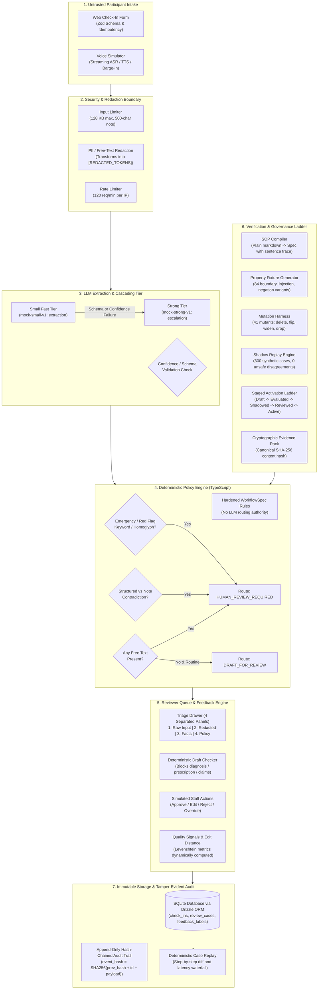

# Careflow Workflow Studio

> **Independent Software Simulation & Portfolio Demonstration**  
> **Synthetic Data Only · Zero Protected Health Information (PHI) · No Clinical Claims**  
> *This repository is an independent software simulation only. All patient names (e.g., `"Demo Patient 001"`), records, and clinical scenarios are invented and synthetic. This system provides strictly no medical advice, diagnosis, or treatment recommendations. Never claim clinical validation, safety certification, HIPAA compliance, production readiness, or affiliation with any healthcare entity.*

---

## Table of Contents
1. [Overview & Public Pitch Context](#overview--public-pitch-context)
2. [Architecture Diagram](#architecture-diagram)
3. [The 3-Minute Guided Demo](#the-3-minute-guided-demo)
4. [Design Decisions & Tradeoffs](#design-decisions--tradeoffs)
5. [Known Limitations](#known-limitations)
6. [What a Real Deployment Would Additionally Need](#what-a-real-deployment-would-additionally-need)
7. [Local Setup & Verification Commands](#local-setup--verification-commands)

---

## Overview & Public Pitch Context

In between-visit patient care, clinics face massive administrative overload reviewing routine check-ins, while facing catastrophic clinical liability if an unconstrained AI hallucinates, gives medical advice, or misses an acute emergency.

**Careflow Workflow Studio** demonstrates a provably safe architecture for clinical workflows:
- **Zero LLM Routing Authority**: Large language models may only extract advisory structured facts or propose draft text. Every triage, escalation, and safety routing decision is 100% deterministic TypeScript.
- **Zero Outbound Effects**: Reviewer actions modify local database state only; no emails, SMS, or EHR alterations are dispatched.
- **Tests-of-Tests Governance**: Automated SOP compilation, reproducible boundary/adversarial fixture generation, a 41-mutant mutation testing harness, shadow replay across 300 cases, and cryptographic Evidence Packs.

---

## Architecture Diagram



---

## The 3-Minute Guided Demo

Anyone can experience the complete governance journey from start to finish via the web interface.

### Running the Guided Demo
1. Start the local server:
   ```bash
   pnpm dev
   ```
2. Navigate to `http://localhost:3000/demo` (or click **"3-Min Guided Demo"** in the sidebar navigation).
3. Click **"Run Full 3-Min Demo"** (for automated execution) or step through manually using **"Execute & Next"**:

| Step | Action | What Happens Under the Hood |
| :---: | :--- | :--- |
| **01** | **Paste Clinic SOP** | Paste plain markdown SOP guidelines with 7 clinic rules. |
| **02** | **Compile & Trace** | The compiler generates a non-binding `WorkflowSpec` proposal with interactive line-by-line sentence-to-rule traceability. |
| **03** | **Auto-Generate Test Suite** | The fixture generator produces 84 reproducible fixtures (seed `42`), testing boundary values (499, 500, 501 chars), prompt injection wrappers, and homoglyphs with $\ge 95\%$ rule coverage. |
| **04** | **Mutation Harness Reveals Weak Spot** | The mutation harness injects 41 mutants. A loosened threshold mutant (`MUTANT_RULE_INPUT_NOTE_LENGTH_WIDEN`) survives without detection, tripping the safety gate to **BLOCKED**. |
| **05** | **Harden Rule & Kill Mutant** | Apply boundary tightening. Re-testing executes the 41-mutant suite; 100% mutants are killed (41/41), achieving a 100.0% mutation score and **PASS** verdict. |
| **06** | **Run Shadow Evaluation** | Replays 300 historical synthetic cases through candidate spec without outbound effects. Verifies 95.3% agreement and **0 unsafe disagreements**. |
| **07** | **Generate Evidence Pack** | Assembles spec, SOP traceability, eval metrics, coverage, and shadow report into a signed JSON/Markdown bundle with canonical SHA-256 hash. |
| **08** | **Staged Activation Ladder** | Promotes spec stage-by-stage: `Draft` $\rightarrow$ `Evaluated` $\rightarrow$ `Shadowed` $\rightarrow$ `Reviewed-by-all` (recording Clinical Lead sign-off) $\rightarrow$ `Active`. |
| **09** | **Concerning Case Lands in Review** | Participant `DEMO-006` submits acute symptoms ("Urgent acute chest pain..."). The deterministic safety rules fire immediately, bypassing AI draft and routing strictly to `HUMAN_REVIEW_REQUIRED`. |
| **10** | **Deterministic Case Replay** | Replays the historical case under candidate spec v2.0.0, rendering a step-by-step diff and latency waterfall confirming route invariance. |

---

## Design Decisions & Tradeoffs

### 1. Deterministic Policy vs Agentic Routing
* **Decision**: Large language models may only extract structured facts or draft non-binding messages. Triage routing, escalation gates, and safety evaluations are written in 100% deterministic TypeScript.
* **Tradeoff**: We surrender "autonomous adaptability" where an agent invents novel routing flows on the fly. In clinical healthcare, autonomous routing creates unacceptable malpractice liability. Deterministic TypeScript ensures that rules can be audited, unit-tested, mathematically proven, and formally verified.

### 2. Mock-First Architecture
* **Decision**: The system runs by default on high-fidelity, deterministic mock LLM adapters with simulated failure injection modes (timeout, malformed JSON, schema violation, tier cascade).
* **Tradeoff**: Real LLM API calls have non-deterministic variance, latency unpredictability, and external rate limits. Mock-first allows our entire CI pipeline (300 unit tests, 41 mutants, 300 shadow replays) to run in seconds with zero API keys and zero flaky tests.

### 3. No Heavy Agent Frameworks (No LangChain / CrewAI)
* **Decision**: Zero reliance on heavyweight agentic wrapper frameworks. We use clean, typed TypeScript domain services and Drizzle ORM.
* **Tradeoff**: We write our own state machines and schema validations, avoiding brittle multi-turn prompt chains, hidden background tool executions, and security vulnerabilities associated with arbitrary tool-calling loops.

### 4. Tests-of-Tests (Mutation Harness & Property Generation)
* **Decision**: We don't assume a passing test suite is sufficient. We test the tests by mutating the policy engine rules (flipping routes, dropping normalization steps, shifting numerical boundaries) and asserting that the test suite catches every mutation.
* **Tradeoff**: Running mutation suites adds computational overhead (~15-20 seconds per run), but guarantees that no dead rules or untested safety boundaries exist before code reaches production.

---

## Known Limitations

1. **Simulation Scope**: Designed strictly as an independent software simulation with synthetic demo data. It does not interface with live hospital paging systems or telephony carriers.
2. **Deterministic Keyword & Homoglyph Matching**: The safety filter handles exact red flags, typo normalization, and Unicode homoglyphs (Cyrillic, fullwidth, zero-width joiners). However, highly nuanced or metaphoric expressions of distress that do not match known linguistic patterns require human reviewer evaluation under the untrusted free-text policy.
3. **No Clinical Advice Capabilities**: The draft checker intentionally prevents any medical diagnosis, treatment advice, or medication change recommendations. Drafts are limited to routine administrative scheduling and confirmation messages.
4. **Mock Audio Waveforms**: The voice simulator stubs streaming ASR and TTS latency using real system timers (`performance.now()`), but does not process real analog acoustic speech signals.

---

## What a Real Deployment Would Additionally Need

To transition this architectural prototype into a live, production-grade clinical environment, an organization would need to implement:

1. **Security & Infrastructure**:
   - Mutual TLS (mTLS) between microservices and edge API gateways.
   - Hardware Security Module (HSM) or AWS KMS envelope encryption for data at rest.
   - Role-Based Access Control (RBAC) integrated with enterprise Identity Providers (Okta, Azure AD SAML/OIDC).
   - SOC 2 Type II compliance audit and continuous intrusion detection.

2. **Privacy & Legal Compliance**:
   - Formal HIPAA Business Associate Agreements (BAAs) with all hosting and infrastructure vendors.
   - De-identification pipeline adhering to HIPAA Safe Harbor (45 CFR § 164.514(b)) or Expert Determination methods.
   - Legal review of all patient-facing terms of use and explicit disclaimers confirming the service is not for acute emergency medical care.

3. **Clinical Governance**:
   - Institutional Review Board (IRB) or clinical ethics committee protocol approval.
   - Physician-in-the-loop oversight with clinical validation studies measuring concordance against board-certified physicians.
   - Formal FDA Software as a Medical Device (SaMD) regulatory evaluation.

4. **Production EHR Integration**:
   - Bidirectional HL7 FHIR R4 interfaces (`Encounter`, `Observation`, `Communication`, `QuestionnaireResponse`).
   - SMART on FHIR authorization for clinician single sign-on inside Epic MyChart or Cerner Millennium.
   - Real telephony SIP trunk integration (Twilio Voice, Amazon Chime SDK) with carrier-grade WebRTC audio streaming.

---

## Local Setup & Verification Commands

### Prerequisites
- Node.js $\ge 20$ (v22 recommended)
- pnpm $\ge 9$
- Python $\ge 3.11$ (for legacy schema migration verification tests)

### Quick Start
```bash
# 1. Install dependencies
pnpm install

# 2. Run local development server
pnpm dev

# 3. Access web interface
# Guided Demo:        http://localhost:3000/demo
# Review Queue:       http://localhost:3000
# Patient Check-In:   http://localhost:3000/web
# Voice Simulator:    http://localhost:3000/voice-sim
```

### Complete Verification Suite
Run the full integrity pipeline (TypeScript check, ESLint, secrets scan, Vitest suite, CI gate check, Python migration tests, and production build):

```bash
node scripts/verify-integrity.mjs
```

### Individual Commands
```bash
# TypeScript static type check (0 errors)
pnpm check

# ESLint code quality scan (0 errors)
pnpm lint

# Run all 300 unit, integration, chaos, and security tests
pnpm test

# Run fixture evaluation suite
pnpm eval

# Run mutation testing harness
pnpm mutate

# Scan repository for secrets, API tokens, and credentials
pnpm security:scan

# Run Playwright end-to-end browser tests
pnpm test:e2e
```
